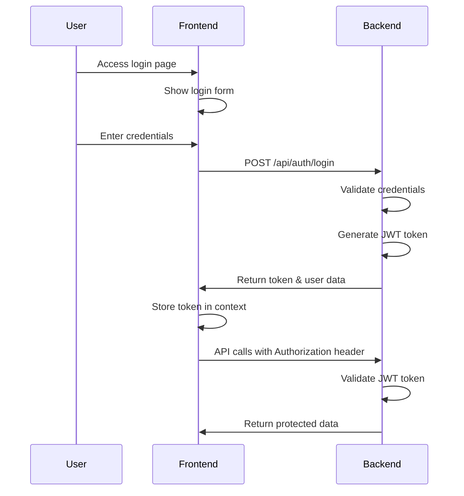

# Frontend Authentication Integration Guide

## ✅ Current Status: JWT Authentication Working

Meeting-Ops currently uses **JWT (JSON Web Token) authentication** with local user accounts. The system is fully functional and ready for production use.

## Overview
Meeting-Ops uses a JWT-based authentication system with:
- **Local accounts** (username/password stored in PostgreSQL)
- **Role-based access** (admin/user roles)
- **Secure password hashing** (bcrypt)
- **Token-based sessions** (30-minute expiry with refresh)

## Authentication Flow



## 🔑 Authentication Methods

### Current: JWT Local Accounts
Users authenticate with local username/password accounts:
- **Admin account**: `admin` / `admin123` (superuser role)
- **User account**: `user` / `user123` (standard role)
- Passwords are bcrypt hashed for security
- JWT tokens expire after 30 minutes
- Automatic token refresh on valid requests

## 📋 Frontend Implementation

### Key URLs
```javascript
// Current working configuration
const API_CONFIG = {
  // Frontend application
  FRONTEND_URL: 'http://localhost:7778',
  
  // API backend
  API_BASE_URL: 'http://localhost:9050',
  
  // WebSocket endpoint
  WS_BASE_URL: 'ws://localhost:9050',
  
  // Authentication endpoints
  LOGIN_ENDPOINT: '/api/auth/login',
  LOGOUT_ENDPOINT: '/api/auth/logout', 
  ME_ENDPOINT: '/api/auth/me',
  
  // API Documentation
  DOCS_URL: 'http://localhost:9050/docs',
};
```

### Authentication Headers
When authenticated with JWT, include the Bearer token in ALL API requests:

```javascript
// Required header for authenticated requests
const authHeaders = {
  'Authorization': `Bearer ${token}`,           // JWT token
  'Content-Type': 'application/json',          // Standard JSON header
};

// Example user object returned from login
const userResponse = {
  "access_token": "REMOVED",
  "token_type": "bearer",
  "user": {
    "id": "admin",
    "username": "admin", 
    "email": "admin@meeting-ops.local",
    "role": "superuser",
    "is_active": true
  }
};
```

### Frontend Auth Service

```typescript
// services/AuthService.ts
export class AuthService {
  private user: User | null = null;

  /**
   * Get current user from headers (automatically set by Traefik)
   */
  getCurrentUser(): User | null {
    // These headers are automatically present if authenticated
    const username = this.getHeader('X-authentik-username');
    const email = this.getHeader('X-authentik-email');
    const name = this.getHeader('X-authentik-name');
    const uid = this.getHeader('X-authentik-uid');
    const groups = this.getHeader('X-authentik-groups');

    if (!username || !email) {
      return null;
    }

    return {
      id: uid,
      username,
      email,
      name,
      groups: groups ? groups.split(',') : [],
      isAdmin: groups ? groups.includes('admin') : false,
      isAuthenticated: true
    };
  }

  /**
   * Check if user is authenticated
   */
  isAuthenticated(): boolean {
    return !!this.getCurrentUser();
  }

  /**
   * Redirect to login
   */
  login(returnUrl?: string): void {
    const currentUrl = returnUrl || window.location.href;
    // Authentik will redirect back after successful login
    window.location.href = `${AUTH_URLS.LOGIN_URL}?next=${encodeURIComponent(currentUrl)}`;
  }

  /**
   * Logout user
   */
  logout(): void {
    // Redirect to Authentik logout flow
    window.location.href = AUTH_URLS.LOGOUT_URL;
  }

  /**
   * Get user profile from Authentik API
   */
  async getUserProfile(): Promise<UserProfile> {
    const response = await fetch(AUTH_URLS.PROFILE_URL, {
      credentials: 'include',  // Important: Include cookies
      headers: {
        'Accept': 'application/json',
      }
    });

    if (!response.ok) {
      throw new Error('Failed to fetch user profile');
    }

    return response.json();
  }

  /**
   * Helper to get header value
   */
  private getHeader(name: string): string | null {
    // In React/Vue/Angular, you might get these from:
    // 1. Initial page load (server-side rendered)
    // 2. Meta tags injected by backend
    // 3. API response headers
    // 4. Special endpoint that returns current user
    
    // Example: Get from meta tag injected by backend
    const meta = document.querySelector(`meta[name="${name}"]`);
    return meta ? meta.getAttribute('content') : null;
  }
}
```

### React Component Example

```jsx
// components/UserMenu.jsx
import React, { useState, useEffect } from 'react';
import { AuthService } from '../services/AuthService';

export function UserMenu() {
  const [user, setUser] = useState(null);
  const authService = new AuthService();

  useEffect(() => {
    // Get user from headers
    const currentUser = authService.getCurrentUser();
    setUser(currentUser);

    // Optionally fetch full profile
    if (currentUser) {
      authService.getUserProfile()
        .then(profile => {
          setUser({...currentUser, ...profile});
        })
        .catch(console.error);
    }
  }, []);

  if (!user) {
    return (
      <button onClick={() => authService.login()}>
        Login
      </button>
    );
  }

  return (
    <div className="user-menu">
      <span>{user.name || user.username}</span>
      <span>{user.email}</span>
      {user.isAdmin && <span className="badge">Admin</span>}
      <button onClick={() => authService.logout()}>
        Logout
      </button>
    </div>
  );
}
```

### API Calls

```javascript
// services/ApiService.js
class ApiService {
  async fetchData(endpoint) {
    // Authentication headers are automatically added by Traefik
    // No need to manually add tokens or auth headers!
    const response = await fetch(`${AUTH_URLS.API_URL}${endpoint}`, {
      credentials: 'include',  // Important: Include cookies
      headers: {
        'Content-Type': 'application/json',
        // Auth headers are automatically added by proxy
      }
    });

    if (response.status === 401) {
      // User not authenticated, redirect to login
      window.location.href = AUTH_URLS.LOGIN_URL;
      return;
    }

    if (!response.ok) {
      throw new Error(`API error: ${response.status}`);
    }

    return response.json();
  }

  async createSession(data) {
    return this.fetchData('/api/simple/recording-sessions', {
      method: 'POST',
      body: JSON.stringify(data)
    });
  }
}
```

### WebSocket Connection

```javascript
// services/WebSocketService.js
class WebSocketService {
  connect(sessionId) {
    // WebSocket connections also get authenticated automatically
    this.ws = new WebSocket(`${AUTH_URLS.WS_URL}/ws/transcription/${sessionId}`);
    
    this.ws.onopen = () => {
      console.log('WebSocket connected (authenticated)');
    };

    this.ws.onerror = (error) => {
      if (error.code === 401) {
        // Not authenticated
        window.location.href = AUTH_URLS.LOGIN_URL;
      }
    };

    return this.ws;
  }
}
```

## 🎨 UI Considerations

### Login Button
```jsx
// Show login button when not authenticated
{!user && (
  <Button onClick={() => window.location.href = AUTH_URLS.LOGIN_URL}>
    Sign In with SSO
  </Button>
)}
```

### User Display
```jsx
// Display user info from headers
<div className="user-info">
  <Avatar src={user.avatar} />
  <div>
    <div>{user.name}</div>
    <div className="text-sm">{user.email}</div>
    <div className="text-xs">{user.groups.join(', ')}</div>
  </div>
</div>
```

### Role-Based UI
```jsx
// Show/hide features based on groups
{user.groups.includes('admin') && (
  <AdminPanel />
)}

{user.groups.includes('Meeting-Ops-Managers') && (
  <ManagerDashboard />
)}
```

## 🔒 Security Notes

1. **No Token Management**: Authentication is handled by Authentik/Traefik
2. **Automatic Headers**: User info comes from secure headers
3. **Cookie-Based**: Session managed by Authentik cookies
4. **CORS Handled**: Traefik manages CORS headers
5. **HTTPS Only**: All communication must be over HTTPS

## 🧪 Testing Authentication

### Local Development
For local development without full SSO:

```javascript
// Mock auth headers for development
if (process.env.NODE_ENV === 'development') {
  // Set mock headers or use development mode
  window.__AUTH_HEADERS__ = {
    'X-authentik-username': 'dev-user',
    'X-authentik-email': 'dev@test.com',
    'X-authentik-name': 'Dev User',
    'X-authentik-groups': 'admin,users'
  };
}
```

### Testing with Docker
```bash
# Start the full stack
docker compose -f docker-compose-sso.yml up

# Access the app
# https://meeting-ops.local - Will redirect to login if not authenticated
```

## 📊 User State Management

### Vuex/Pinia Store Example
```javascript
// stores/auth.js
export const useAuthStore = defineStore('auth', {
  state: () => ({
    user: null,
    isAuthenticated: false,
  }),

  actions: {
    async fetchUser() {
      try {
        // Get user from headers or API
        const authService = new AuthService();
        const user = authService.getCurrentUser();
        
        if (user) {
          this.user = user;
          this.isAuthenticated = true;
        }
      } catch (error) {
        console.error('Failed to fetch user:', error);
        this.user = null;
        this.isAuthenticated = false;
      }
    },

    login() {
      window.location.href = AUTH_URLS.LOGIN_URL;
    },

    logout() {
      this.user = null;
      this.isAuthenticated = false;
      window.location.href = AUTH_URLS.LOGOUT_URL;
    }
  }
});
```

## 🔄 Auto-Login Flow

```javascript
// App.jsx - Main component
useEffect(() => {
  // Check if user is authenticated on app load
  const authService = new AuthService();
  const user = authService.getCurrentUser();
  
  if (!user && !isPublicRoute(window.location.pathname)) {
    // Not authenticated and not on public route
    // Store current URL and redirect to login
    sessionStorage.setItem('returnUrl', window.location.href);
    authService.login();
  }
}, []);
```

## 📝 Environment Variables

```env
# .env for frontend
VITE_APP_URL=https://meeting-ops.local
VITE_API_URL=https://api.meeting-ops.local
VITE_WS_URL=wss://api.meeting-ops.local
VITE_AUTH_URL=https://auth.meeting-ops.local
```

## 🚀 Quick Start for Frontend Developer

1. **No authentication code needed** - It's handled by the proxy
2. **User info in headers** - Automatically available on all requests
3. **Simple login/logout** - Just redirect to Authentik URLs
4. **API calls work normally** - Auth headers added automatically
5. **WebSockets authenticated** - Same as regular requests

### Minimal Implementation
```javascript
// That's it! The simplest implementation:
const user = {
  username: document.querySelector('meta[name="X-authentik-username"]')?.content,
  email: document.querySelector('meta[name="X-authentik-email"]')?.content,
  name: document.querySelector('meta[name="X-authentik-name"]')?.content,
};

const isLoggedIn = !!user.username;

const login = () => window.location.href = 'https://auth.meeting-ops.local/if/flow/authentication/';
const logout = () => window.location.href = 'https://auth.meeting-ops.local/if/flow/invalidation/';
```

## ❓ FAQ

**Q: How do I get the current user?**
A: Check the `X-authentik-*` headers - they're automatically present if authenticated.

**Q: How do I protect routes?**
A: If no auth headers present, redirect to login URL.

**Q: How do I handle tokens?**
A: You don't! Authentik handles all tokens/sessions via cookies.

**Q: What about CORS?**
A: Traefik handles all CORS configuration.

**Q: Can users sign up?**
A: Yes, if enabled in Authentik. They can also use SSO providers.

**Q: How do I test locally?**
A: Use the development mock headers or run the full Docker stack.