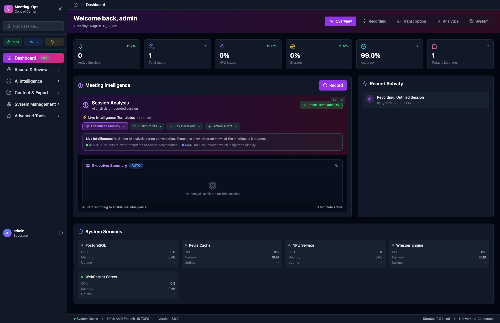

<div align="center">

# 🦄 Meeting-Ops

### The open standard for conversation intelligence.

**Record. Transcribe live. Know who said what. Get AI summaries & action items. Search every meeting you've ever had. Export anything.**
**Open source. No data harvesting. No third-party AI. Host it with us — or run it entirely yourself.**

<br/>

[](./CHANGELOG.md)
[](https://python.org)
[](https://react.dev)
[](https://fastapi.tiangolo.com)
[](./docs/compute-economics.md)
[](#-the-moat-zero-marginal-compute)
[](LICENSE)

*Part of the [Unicorn Commander](https://git.unicorncommander.ai) suite.*

<br/>



</div>

---

## ✨ TL;DR

Most meeting-AI tools (Otter, Granola, Fathom, Fireflies, Read.ai) rent you transcription and summarization that runs on a vendor's GPUs, billed *per audio-minute* and *per token*, *per user*, *continuously*, forever. Your conversations live on their servers.

**Meeting-Ops flips that.** The live transcript and live summary run **in your browser** on small on-device models. The high-quality pass runs **once, at meeting end**, on GPUs *you* own. The result: pro-grade meeting intelligence with a marginal cloud-AI cost of **$0** — and a privacy mode where the audio bytes literally never leave the device.

| | Meeting-Ops | Typical cloud meeting-AI |
|---|---|---|
| Live transcription | 🟣 In your browser (Parakeet) | ☁️ Vendor GPU, per-minute |
| Live summary | 🟣 In your browser (small LLM) | ☁️ Vendor tokens, per-minute |
| Final quality pass | 🟣 Once, on your GPU (~30–90s) | ☁️ Continuous |
| Marginal cloud-AI $/user-hr | **$0** | $0.50–$1.50 |
| Audio at rest | 🟣 Your storage (or device-only) | ☁️ Their cloud |
| Speaker identity across meetings | 🟣 Persistent, self-improving | ⚠️ Usually per-meeting |
| Run fully air-gapped | 🟣 Yes (privacy mode / on-prem) | ❌ No |

---

## 🎬 What it does

<table>
<tr>
<td width="50%" valign="top">

### 🔴 Record & transcribe
Hit record in the browser. Live transcription streams as you talk — mic, system audio, multi-mic conference rooms, satellite devices, or a desktop companion app. Always-on mode auto-segments your day into meetings.

</td>
<td width="50%" valign="top">

### 🧠 Understand
Live rolling summary while you meet; a polished final summary, action items, decisions, and attendees the moment you stop. Per-meeting AI chat ("what did we decide about pricing?") and a person-centric Knowledge Graph.

</td>
</tr>
<tr>
<td width="50%" valign="top">

### 🗣️ Know who said what
Speaker diarization + **persistent speaker identity**: every voice gets a stable identity that carries across meetings. Name someone once and it's fixed in *every* past meeting — instantly. (More below — it's the good part.)

</td>
<td width="50%" valign="top">

### 🔎 Recall everything
Full-text + hybrid semantic search across every meeting. Cross-meeting RAG ("summarize everything we've said about Acme this quarter"). Export to PDF / DOCX / TXT / SRT / JSON / Markdown.

</td>
</tr>
</table>

<div align="center">

| Live recording | Cross-meeting AI chat | Session manager |
|:--:|:--:|:--:|
|  |  |  |

</div>

---

## 🛡️ The moat: zero marginal compute

> The thing that makes Meeting-Ops different isn't the model selection or the UI. **It's that we don't run the per-minute compute. The user's browser does.**

```
┌──────────────────── BROWSER · live work · free to us · runs all meeting ────────────────────┐
│                                                                                              │
│   🎙  Mic ─► VAD (Silero) ─► Parakeet 0.6B INT8 ───────────────► live transcript            │
│                              (onnxruntime-web · WebGPU/WASM)                                  │
│                                                                                              │
│                           ─► small on-device LLM (transformers.js / web-llm) ─► live summary │
│                                                                                              │
│   MediaRecorder ─► 30s WebM/Opus chunks ───────────────┐   uplink ≈ 28 MB/hr                │
│                                                          │                                    │
└──────────────────────────────────────────────────────────┼──────────────────────────────────┘
                                                           │  POST /audio-chunks (every 30s)
                                                           ▼
┌──────────── SERVER · runs ONCE at completion · ~30–90s · idle ecosystem GPU ────────────────┐
│                                                                                              │
│   ffmpeg reassemble ─► Parakeet 1.1B  ──────────────────► word-timestamped transcript        │
│                     ─► pyannote diarization + wespeaker ─► diarized + speaker-matched         │
│                     ─► Qwen 3.6 35B-A3B-Vision (MoE) ───► final summary · actions · attendees │
│                     ─► Infinity (bge-m3) ───────────────► indexed for cross-meeting search    │
│                                                                                              │
└──────────────────────────────────────────────────────────────────────────────────────────────┘
```

The browser stack runs in the tab for the entire meeting. The server stack runs **exactly once** when the meeting ends.

**Why it matters:** competitors pay AssemblyAI/Deepgram per audio-minute and OpenAI/Anthropic per token, per user, continuously. That cost scales linearly with concurrent users. Our marginal cost per concurrent user-hour is **zero** — the user's CPU/GPU does it. Our cost per *completed* meeting is ~30–90 GPU-seconds on hardware we already own. At 1,000 concurrent hour-long meetings, the per-minute crowd burns $500–1,500/hr in live compute; we spend roughly $20 once those meetings finish.

📖 Full strategy: [`docs/compute-economics.md`](./docs/compute-economics.md). *Read it before adding any server-side per-minute service — the architecture is the moat, and we don't give it back by reaching for an external API when the work could go to the browser or fold into the completion pass.*

---

## 🗣️ Speaker intelligence (the good part)

Meeting-Ops doesn't just split a meeting into "Speaker 1 / Speaker 2." It builds a **persistent, self-improving identity** for every voice — and naming a person is a one-time, instant act.

- **Persistent identity across meetings.** When a voice matches no one yet, Meeting-Ops auto-creates a *stable* profile with a durable handle (e.g. `Speaker 3F2A`) instead of a throwaway label. The same voice matches the same profile in the *next* meeting — so people accrue history before you've ever named them.
- **Name once, fixed everywhere — instantly.** The display name is rendered **live** from each person's profile at read time (via the session's speaker links), so renaming a speaker updates *every* past transcript immediately, with **no re-processing**. A rename is a single profile-row update — it doesn't rewrite a single transcript. *(This is the v3.44 → v3.45 architecture: the name lives in exactly one place.)*
- **Confirming is safe (anti-poisoning).** Correcting or confirming a speaker teaches the system that voice — but a **consistency floor** means a mislabeled or mixed-voice segment can't corrupt a saved voiceprint. Confirming only ever improves accuracy.
- **Browser = full quality.** Recording in the browser now runs the *same* full transcription + diarization + identification pipeline as uploading a file. No quality penalty for staying in the tab.

🔧 Deep dive: [`docs/speaker-intelligence-design.md`](./docs/speaker-intelligence-design.md) — data model, identification math, the enrollment floor, and the dynamic-rendering single-source-of-truth.

---

## 🔒 Privacy & sovereignty

- **Privacy mode** is a per-session toggle: the entire browser stack is self-contained, so turning the server step off means **audio bytes never leave the device**. Orthogonal to pricing — anyone can flip it on; enterprise/HIPAA deployments default it on.
- **Your storage, your delete.** Canonical audio lives in **Garage** (S3-compatible) on *your* hardware, not a third-party cloud. Deleting a session purges its objects, its vectors (Qdrant), and its chat history — "delete my data" actually deletes.
- **No third-party AI APIs.** Every model — STT, diarization, LLM, embeddings, TTS — runs on infrastructure you control, fronted by a self-hosted LiteLLM gateway.
- **SSO-native.** Forward-auth trust boundary, per-workspace billing, WebSocket handshake auth, HTTP security headers, per-room retention opt-in.

---

## 🧱 The stack (what actually runs)

| Job | Live (browser) | Completion pass (server) |
|---|---|---|
| **STT** | Parakeet 0.6B INT8 (onnxruntime-web) | **Parakeet 1.1B** |
| **Diarization** | — | **pyannote** (`speaker-diarization-community-1`, 3.1 fallback) + `wespeaker` embeddings, via `meet-speaker-svc` |
| **LLM** (summary / titles / chat / insights) | small on-device LLM (transformers.js / web-llm) | **Qwen 3.6 35B-A3B-Vision** (MoE, ~3B active) via LiteLLM · fast model `gemma-4-e4b` |
| **Embeddings + reranking** | BM25 sparse (local) | **Infinity** — `bge-m3` (1024-d dense) + `bge-reranker-v2-m3` |
| **TTS** (vocal summaries) | — | **Kokoro** (`af_heart`) |

**App:** React 19 + TypeScript + Vite + Tailwind frontend · FastAPI (Python 3.13) backend (64 routers, deep readiness probes) · PostgreSQL · Redis (pub/sub + Arq reprocess queue) · Qdrant (hybrid dense + sparse) · LiteLLM gateway. Cloud and on-prem appliance builds ship from one codebase via compose targets.

---

## 🚀 Quick start

```bash
# 1. Infrastructure — PostgreSQL, Redis, Qdrant (the LLM is reached via the LiteLLM gateway)
docker compose -f docker-compose-full-stack.yml up -d

# 2. Backend (port 9050)
cd backend && ./start-backend.sh

# 3. Frontend (port 7777)
cd frontend && npm run dev -- --host 0.0.0.0
```

Then open **http://localhost:7777** — API docs live at **http://localhost:9050/docs**.

> **Login:** `admin` / `admin123` (superuser) for local dev. Production uses SSO.

One-shot installer: [`install-meeting-ops.sh`](./install-meeting-ops.sh) · See [`INSTALL.md`](./INSTALL.md) and [`QUICK-START.md`](./QUICK-START.md) for the appliance path.

### Tests

```bash
cd backend && python3 -m pytest tests/ -q     # backend pytest suite
cd frontend && npx tsc -b                       # strict type-check (project references)
cd frontend && npx vitest run                   # frontend unit tests
```

---

## 🎚️ Tier model

| | Free | Pro | Enterprise |
|---|---|---|---|
| Live browser transcript + summary | ✅ | ✅ | ✅ |
| On-device privacy mode | ✅ | ✅ | ✅ (default on) |
| Server completion pass (Parakeet 1.1B + pyannote + Qwen 3.6) | — | ✅ | ✅ |
| Server-live streaming, durable storage, bulk import | — | ✅ | ✅ |
| Speaker library, retention controls, BYOK Brigade graph, HIPAA, on-prem | — | — | ✅ |

Free tier is enforced server-side (server-compute endpoints `403` free users); the frontend auto-routes free users to the on-device/local-only path. Consumer self-serve signup is built and inert until pricing/checkout is activated; SSO users are unaffected.

---

## 🔌 API at a glance

<details>
<summary><b>Recording, sessions & search</b></summary>

```
POST /api/simple/recording-sessions                    # create a session
POST /api/simple/recording-sessions/{id}/start|stop    # start / stop recording
GET  /api/simple/recording-sessions                    # list (cursor-paginated)
GET  /api/simple/recording-sessions/{id}               # session + transcript (names rendered live)
GET  /api/simple/recording-sessions/search?q=...       # full-text search
GET  /api/simple/recording-sessions/semantic-search?q= # hybrid semantic search (Qdrant)
```
</details>

<details>
<summary><b>AI: chat, RAG, insights, export</b></summary>

```
POST /api/ai-chat/sessions/{id}/messages               # chat with one meeting
POST /api/ai-chat/rag/query                             # cross-meeting RAG (multi-turn)
GET  /api/simple/recording-sessions/{id}/insights       # keywords, sentiment, action items
GET  /api/simple/recording-sessions/{id}/download/summary/pdf|docx   # exports (+ txt/json/srt/md)
```
</details>

<details>
<summary><b>Speakers, satellites & live</b></summary>

```
PATCH /api/speakers/{id}                                # rename a speaker (instant, propagates everywhere)
POST  /api/speakers/{id}/resummarize-history            # re-summarize a speaker's past meetings
WS    /ws/transcription/{session_id}                    # live transcription
WS    /ws/satellite/{device_id}/audio                   # real-time satellite audio
WS    /ws/remote-audio/{session_id}                     # desktop companion app
GET   /health                                           # health + router status
```
</details>

**MCP server** (`mcp/meeting_ops_mcp.py`): 8 tools (search, ask, list, details, transcript, chat, analytics, insights) + resources + prompts over stdio — drop Meeting-Ops into Claude Desktop, Open WebUI, or any MCP client.

---

## 🗺️ Status & roadmap

**Live on prod (`unicorncommander.ai`) + dogfood (`magicunicorn.dev`) — v3.45.0:**

- ✅ Browser-first capture + server completion pass · privacy mode
- ✅ Speaker intelligence: persistent identity, anti-poisoning floor, **fully dynamic name rendering** (rename once → fixed everywhere, instantly)
- ✅ Person-centric Knowledge Graph (GA) · cross-meeting search + RAG
- ✅ Phase B server-live streaming (Sortformer/Parakeet realtime) · tier gating
- ✅ Garage audio object storage (durable, self-hosted) · session-delete erasure
- ✅ Enterprise/SaaS hardening: SSO forward-auth boundary, per-workspace billing, deep readiness probes, Arq retries, Sentry + metrics

**In flight:** native iOS (Phase C-1, builds sim-green) → on-device summary → watchOS · `unicorncommander.ai` consumer launch + checkout · appliance extraction for on-prem.

📚 Full design library: [`docs/README.md`](./docs/README.md) · Per-release history: [`CHANGELOG.md`](./CHANGELOG.md) · Contributor guide: [`CLAUDE.md`](./CLAUDE.md)

---

<div align="center">

**Meeting-Ops** — conversation intelligence that earns enterprise trust *and* individual delight.

*Open source · enterprise-ready · host it with us, or run it entirely yourself.*

[Releases](./CHANGELOG.md) · [Docs](./docs/README.md) · [Unicorn Commander](https://git.unicorncommander.ai)

</div>

## License

MIT — see [LICENSE](LICENSE).
