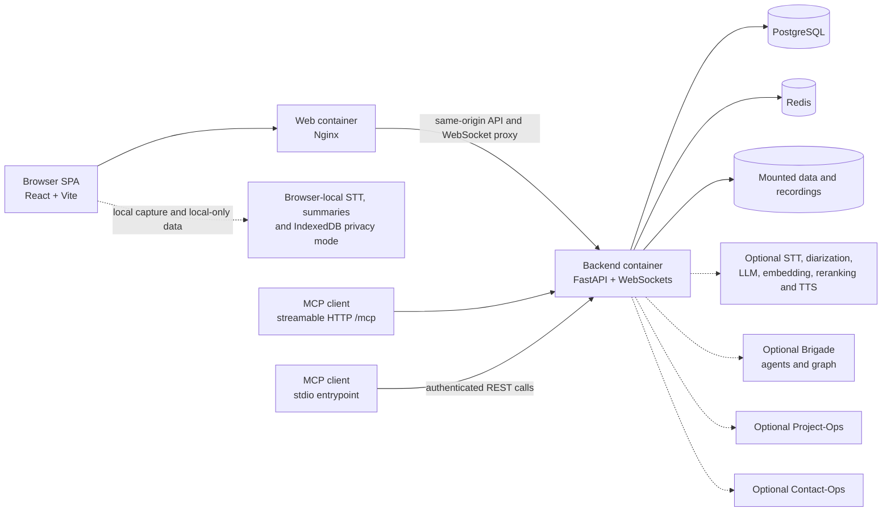

<p align="center">
  
</p>

<h1 align="center">Meeting-Ops</h1>

<p align="center">
  <strong>Self-hosted meeting recording that turns conversations into searchable transcripts, summaries, decisions, and action items.</strong>
</p>

<p align="center">
  <a href="./VERSION"></a>
  <a href="./LICENSE"></a>
  <a href="./backend"></a>
  <a href="./frontend"></a>
  <a href="./docker-compose.selfhost.yml"></a>
  <a href="./docker-compose.selfhost.yml"></a>
  <a href="./docs/mcp-hosted.md"></a>
</p>

<p align="center">
  <a href="#quick-start-docker">Quick start</a> ·
  <a href="#highlights">Features</a> ·
  <a href="#built-for-agents">Agents</a> ·
  <a href="#architecture">Architecture</a> ·
  <a href="#part-of-unicorn-commander">Suite</a>
</p>

<p align="center">
  
</p>

## What is Meeting-Ops?

Meeting-Ops is a self-hosted workspace for recording meetings, processing audio into transcripts and summaries, and keeping decisions and action items attached to the source conversation. It is built for teams who want agents to search, analyze, and propose follow-up work while humans approve changes. Where the browser supports it, privacy mode keeps recording bytes, transcripts, summary slices, and summaries in IndexedDB; the normal workspace path is organization-scoped and persisted by the backend. Meeting-Ops is part of Unicorn Commander, using organization-scoped identity and offering optional data paths to Brigade, Project-Ops, and Contact-Ops.

## Highlights

- Record from the browser with a live transcript and rolling summary, so the meeting stays useful while it is still happening.
- Upload audio or video through the same processing pipeline, bringing existing recordings into the searchable workspace.
- Review a complete meeting record with transcript, speaker labels, summary, decisions, action items, audio, chat, and export options in one place.
- Search across meetings with hybrid semantic and keyword retrieval, then ask grounded questions with meeting citations instead of browsing an archive by hand.
- Explore a person-centered knowledge graph spanning meetings, co-speakers, topics, decisions, and action items when the graph integration is configured.
- Use browser-local privacy mode to keep recording bytes, transcript data, and summary data on the device; the mode is gated on browser WebGPU support.
- Connect an AI client through MCP for search, analysis, transcript access, and controlled imports; write actions use a proposal-and-confirmation flow.
- Keep workspaces organization-scoped with role-aware access, personal access tokens, and optional Brigade, Project-Ops, and Contact-Ops integrations.

## Feature tour

### Review a meeting

<p align="center">
  
</p>

*A meeting: summary, decisions, action items.*

Session details keep the final brief beside the transcript, speakers, audio, action items, per-meeting chat, and exports. The meeting remains the source record while follow-up work can be reviewed and linked to sibling systems.

### Record with live context

<p align="center">
  
</p>

*Live recording with a live transcript and rolling summary.*

The recording surface combines browser capture, live transcription, progressive summaries, and stop-time finalization. Choose the browser-local path where supported, or use the configured server/provider pipeline for workspace processing.

### Connect the dots

<p align="center">
  
</p>

*Knowledge graph across meetings.*

Start with a person and follow their meetings, co-speakers, topics, decisions, and action items. The graph view is organization-scoped and hydrates display details from Meeting-Ops records; Brigade supplies the graph integration when enabled.

### Ask across the archive

<p align="center">
  
</p>

*Ask questions across every meeting.*

The dashboard ask bar and AI Chat use the local Meeting Assistant to search, retrieve, and synthesize from meeting data with citations. Optional Brigade agents can appear in the same agent picker and stream answers through the authenticated dispatcher.

## Built for agents

Meeting-Ops exposes the same meeting intelligence through the Model Context Protocol and through an authenticated in-app agent dispatcher.

### MCP transports and permissions

- **Hosted streamable HTTP:** the self-host compose enables `http://localhost:9050/mcp`; clients send `Authorization: Bearer <mops_pat_placeholder>` on each request.
- **stdio:** run [`mcp/meeting_ops_mcp.py`](mcp/meeting_ops_mcp.py) for clients that launch local MCP servers. It talks to the Meeting-Ops REST API and uses the same shared tool definitions as hosted MCP.
- **Authorization:** the PAT is resolved through the existing user and organization authorization path. MCP does not grant a privileged bypass, and proposal tools do not mutate until a confirmation call is made.

At this revision the shared server registers **eighteen tools**:

| Surface | Tools |
|---|---|
| Read-only search and analysis | `search_meetings`, `ask_about_meetings`, `list_meetings`, `get_meeting_details`, `get_meeting_transcript`, `chat_with_meeting`, `get_analytics`, `get_meeting_insights`, `get_cross_app_hints` |
| Server-side media import | `import_recording` |
| Proposal and confirmation flow | `propose_create_session`, `propose_rename_session`, `propose_add_tag`, `propose_remove_tag`, `propose_trigger_reprocess`, `propose_draft_followup_email`, `confirm_action`, `cancel_action` |

The server also provides the `meetings://list` and `meetings://{session_id}` resources plus the `meeting_analysis` and `cross_meeting_research` prompts. See [`docs/mcp-hosted.md`](docs/mcp-hosted.md) for client notes and the full behavior contract.

### Connect a client

Create a user-scoped PAT in **Settings → Personal Access Tokens**, then add the hosted endpoint to an MCP client that supports streamable HTTP:

```json
{
  "mcpServers": {
    "meeting-ops": {
      "url": "http://localhost:9050/mcp",
      "headers": {
        "Authorization": "Bearer <mops_pat_placeholder>"
      }
    }
  }
}
```

The API equivalent for the local bootstrap admin is below. The installer prints the generated username and password once; replace the placeholders with those generated values, then copy the returned access token into the PAT request.

```bash
curl -fsS -X POST http://localhost:9050/api/auth/login \
  -H 'Content-Type: application/x-www-form-urlencoded' \
  --data-urlencode 'username=<generated-admin-username>' \
  --data-urlencode 'password=<generated-admin-password>'

curl -fsS -X POST http://localhost:9050/api/auth/pats \
  -H 'Authorization: Bearer <access-token-from-login-response>' \
  -H 'Content-Type: application/json' \
  -d '{"name":"my-agent","scope":"user"}'
```

The PAT plaintext is returned only when it is created. Put it in the client’s secret store and never commit it.

### Other agent hooks

The authenticated `/api/agents` dispatcher exposes the local `meeting-rag` assistant and can federate optional Brigade agents. Chat responses stream as server-sent events, while agent write actions use `/api/agent-actions/propose`, `/api/agent-actions/confirm`, and `/api/agent-actions/cancel` so a person remains in the approval loop.

## Quick start (Docker)

The maintained self-host path is Docker-only. Install Docker Engine with Docker Compose v2, plus `curl` and `openssl`; [`install-meeting-ops.sh`](install-meeting-ops.sh) checks those prerequisites before it changes anything.

```bash
git clone https://github.com/Unicorn-Commander/Meeting-Ops.git
cd Meeting-Ops
./install-meeting-ops.sh
```

The installer builds the checked-in backend and web images, starts PostgreSQL, Redis, the FastAPI backend, and the web container, initializes the database schema, and creates a local bootstrap admin. No external identity provider is required for this path: sign in with the generated local username and password printed by the installer.

Open the UI at <http://localhost:7777>. The API health check is:

```bash
curl -fsS http://localhost:9050/health
```

FastAPI’s interactive API docs are at <http://localhost:9050/docs>.

The self-host compose binds these default ports to the local machine:

| Component | Port |
|---|---:|
| Web UI | `7777` |
| API | `9050` |
| PostgreSQL | `5434` |
| Redis | `6381` |

The base stack does not start separate model or suite services. Its Compose network is internal, and published ports bind to loopback. If you have provider services available, set the corresponding compose-supported endpoint variables in the generated `.env` and restart the backend; keep provider credentials out of Git:

```bash
docker compose --env-file .env -f docker-compose.selfhost.yml up -d
```

### Stop and inspect

```bash
docker compose --env-file .env -f docker-compose.selfhost.yml ps
docker compose --env-file .env -f docker-compose.selfhost.yml logs backend
docker compose --env-file .env -f docker-compose.selfhost.yml down
```

The normal `down` command preserves the named PostgreSQL and Redis volumes. Do not add `-v` unless you intentionally want to remove that local data.

## Run from source (dev)

The checked-in development compose mounts the backend and frontend source trees, uses SQLite for the backend, and serves the Vite frontend separately. It maps the host audio device at `/dev/snd`, so use a development host with that device available when exercising microphone capture.

```bash
docker compose -f docker-compose.dev.yml up --build
```

Open the development UI at <http://localhost:5173>; the development API is at <http://localhost:9050>. Stop it with:

```bash
docker compose -f docker-compose.dev.yml down
```

## Configuration

The installer creates an untracked `.env` with generated deployment and admin values and sets its permissions to owner-only. The top-level [`.env.example`](.env.example) documents application settings; it contains placeholders and is not a replacement for the installer-generated file.

Important settings documented by `.env.example`:

| Variable | Meaning |
|---|---|
| `DATABASE_URL` | SQLAlchemy database connection used by the backend. |
| `SECRET_KEY` | Deployment-specific signing secret for application tokens; real deployments require a strong value. |
| `HUGGINGFACE_TOKEN` | Optional model-access token used by the speaker/diarization service when its gated models are enabled. |
| `UPLOAD_WATCHDOG_MINUTES` | How long an upload job may make no progress before the watchdog marks it retryable. |
| `MEETING_RETENTION_ENABLED` | Enables the data-retention worker. |
| `MEETING_RETENTION_DAYS` | Retention age used when the retention worker is enabled. |
| `MEETING_RETENTION_MAX_PER_RUN` | Upper bound for records handled by one retention pass. |

The installer manages the database, admin, URL, CORS, and port settings; it uses the admin values during bootstrap, while the compose enables hosted MCP and passes runtime values to the backend. The compose also supports optional provider and integration endpoints such as `LITELLM_API_BASE`, `INFINITY_ENDPOINT`, `PARAKEET_SERVER_URL`, `SPEAKER_SVC_URL`, `KOKORO_ENDPOINT`, `BRIGADE_API_BASE_URL`, `PROJECTOPS_BASE_URL`, and `CONTACT_OPS_MCP_URL`. These names are passed to the backend by [`docker-compose.selfhost.yml`](docker-compose.selfhost.yml); configure only the services you intend to use.

## Architecture



- **Browser SPA:** React/Vite UI for capture, live transcription, summaries, session review, search, graph exploration, and AI Chat. Browser-local privacy mode uses IndexedDB when the browser exposes WebGPU.
- **Web container:** Nginx serves the built frontend and proxies API and WebSocket traffic to the backend in the self-host compose.
- **Backend:** FastAPI owns authentication, organization scoping, uploads, recording sessions, processing jobs, search/RAG, integrations, agent dispatch, and both MCP transports.
- **PostgreSQL:** durable application records, users, organizations, sessions, transcripts, summaries, and action-item state.
- **Redis:** cache, queues, and realtime support used by the backend.
- **Mounted storage:** the compose mounts `data` and `recordings`; deployments can disable server media storage or point processing at configured providers.
- **Optional integrations:** provider services supply server-side speech/AI capabilities; Brigade, Project-Ops, and Contact-Ops are reached only when their integration paths are configured.

## Part of Unicorn Commander

| App | What it does |
|---|---|
| [Ops-Center](https://github.com/Unicorn-Commander/Ops-Center) | The control plane: tenants, billing, federation, API keys, model routing |
| [Unicorn-Brigade](https://github.com/Unicorn-Commander/Unicorn-Brigade) | The agent layer: agents, tools, memory, orchestration |
| [Unicorn-Stable](https://github.com/Unicorn-Commander/Unicorn-Stable) | Humans and agents in the same room: chat, voice, video |
| [Accounting-Ops](https://github.com/Unicorn-Commander/Accounting-Ops) | Agent-native accounting and books |
| [Contact-Ops](https://github.com/Unicorn-Commander/Contact-Ops) | The shared contact and identity graph |
| [Customer-Ops](https://github.com/Unicorn-Commander/Customer-Ops) | Customers, pipeline, quotes and outreach |
| [Email-Ops](https://github.com/Unicorn-Commander/Email-Ops) | Agent-drafted email with a human approval inbox |
| [Project-Ops](https://github.com/Unicorn-Commander/Project-Ops) | Projects, tasks, time and invoices |
| [**Meeting-Ops**](https://github.com/Unicorn-Commander/Meeting-Ops) | **Recordings, transcripts, summaries and action items** |
| [Knowledge-Ops](https://github.com/Unicorn-Commander/Knowledge-Ops) | The wiki and memory your agents ground on |
| [Security-Ops](https://github.com/Unicorn-Commander/Security-Ops) | Authorized security scanning with engagement and attestation gates |
| [Tax-Planning-Ops](https://github.com/Unicorn-Commander/Tax-Planning-Ops) | Tax plans, scenarios and statutory deadlines |
| [Brand-Ops](https://github.com/Unicorn-Commander/Brand-Ops) | Brand kits, marks, voices and rules |
| [Podcast-Ops](https://github.com/Unicorn-Commander/Podcast-Ops) | Episodes, audio QA and publishing |
| [UUDA](https://github.com/Unicorn-Commander/UUDA) | The device agent for your fleet |
| [fleet-map](https://github.com/Unicorn-Commander/fleet-map) | Fleet inventory and topology map |

Meeting-Ops connects to the suite through organization-scoped identity and optional Brigade graph/agent, Project-Ops action-item, and Contact-Ops participant paths implemented in this repository.

## Development

The repository exposes these checks:

```bash
# Backend + frontend test command from the Makefile
make test

# Frontend lint, build, and focused test commands
cd frontend
npm run lint
npm run build
npm test

# Backend-only tests
cd ../backend
python3 -m pytest tests/ -v
```

See [`CONTRIBUTING.md`](CONTRIBUTING.md) for the small contribution workflow.

## Security

Please report vulnerabilities privately to [security@magicunicorn.tech](mailto:security@magicunicorn.tech) and see [`SECURITY.md`](SECURITY.md). Do not open a public issue with exploit details or credentials. Generated `.env` files and PAT plaintexts belong in a secret store, never in Git, screenshots, logs, or agent configuration checked into the repository.

## Licence

Meeting-Ops is licensed under the GNU Affero General Public License, version 3.0 (AGPL-3.0). See [`LICENSE`](LICENSE).

Built by [Magic Unicorn](https://magicunicorn.tech) · part of [Unicorn Commander](https://unicorncommander.ai)
