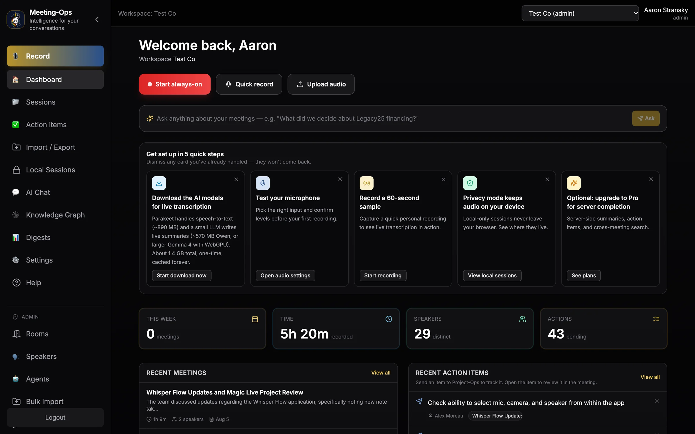
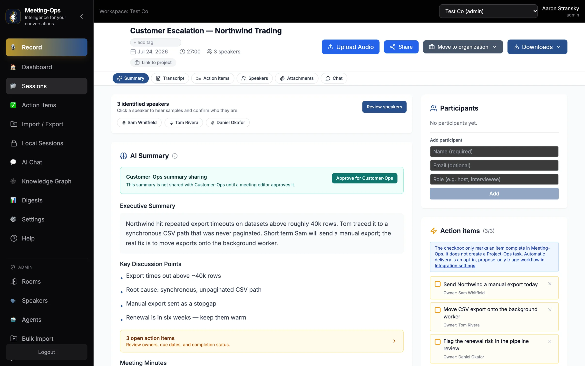
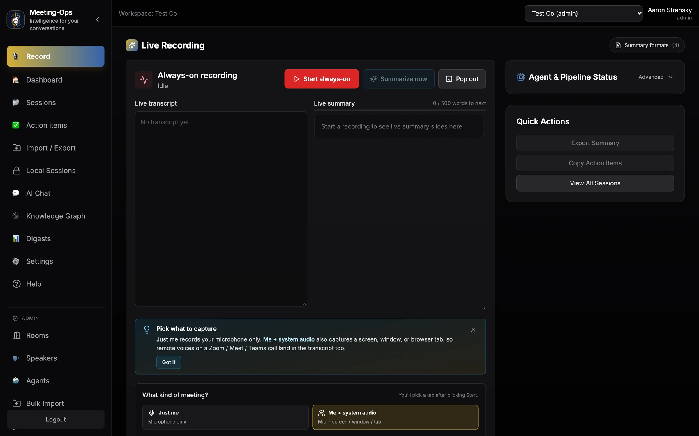
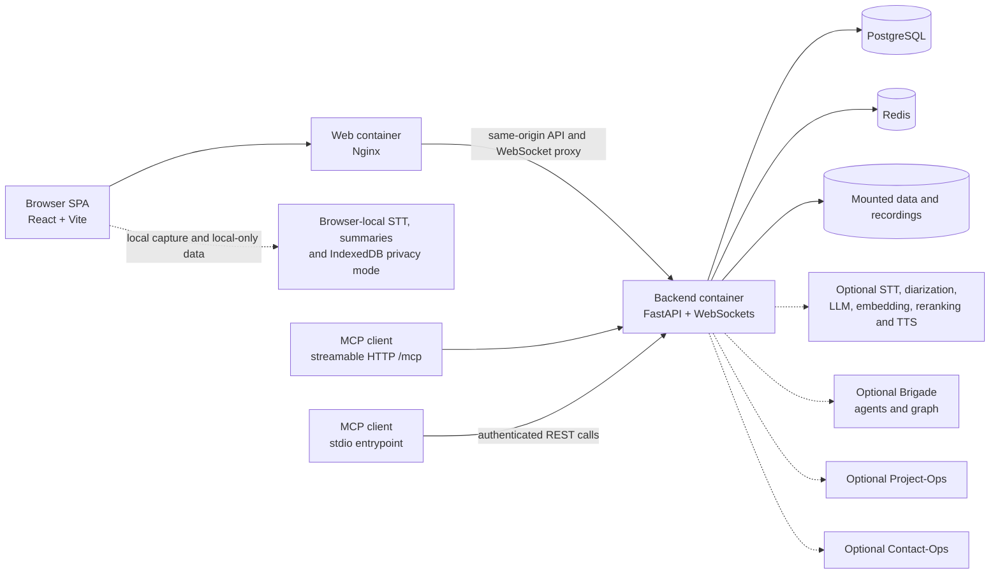

<p align="center">
  
</p>

<h1 align="center">Meeting-Ops</h1>

<p align="center">
  <strong>Self-hosted meeting recording that turns conversations into searchable transcripts, summaries, decisions, and action items.</strong>
</p>

<p align="center">
  <a href="./VERSION"></a>
  <a href="./LICENSE"></a>
  <a href="./backend"></a>
  <a href="./frontend"></a>
  <a href="./docker-compose.selfhost.yml"></a>
  <a href="./docker-compose.selfhost.yml"></a>
  <a href="./docs/mcp-hosted.md"></a>
</p>

<p align="center">
  <a href="#quick-start-docker">Quick start</a> ·
  <a href="#highlights">Features</a> ·
  <a href="#built-for-agents">Agents</a> ·
  <a href="#architecture">Architecture</a> ·
  <a href="#part-of-unicorn-commander">Suite</a>
</p>

<p align="center">
  
</p>

## What is Meeting-Ops?

Meeting-Ops is a self-hosted workspace for recording meetings, processing audio into transcripts and summaries, and keeping decisions and action items attached to the source conversation. Agents can search, analyze, and propose follow-up work; a person confirms before a proposal changes data. Where the browser exposes WebGPU, privacy mode keeps recording bytes, transcripts, summary slices, and summaries in IndexedDB. The workspace path is organization-scoped and persisted by the backend. Meeting-Ops is part of Unicorn Commander. Optional paths in this repository call Brigade, Project-Ops, and Contact-Ops when those integrations are configured.

## Highlights

- On browsers that can run the on-device models, record in the browser with a live transcript and a rolling summary while the meeting is still going.
- Upload audio or video into the same processing pipeline. Server-side transcription, diarization, and summary of that upload run when the matching providers are configured.
- Review a meeting with its transcript, speakers, summary, decisions, action items, audio, per-meeting chat, and downloads.
- Search meetings in the active organization. Semantic retrieval runs when Qdrant and an embedding endpoint answer; otherwise search uses keyword matching on title, transcript, and summary. The Meeting Assistant can answer from those meetings and return sources when a completion provider is configured.
- Open a person-centered knowledge graph of meetings, co-speakers, topics, decisions, and action items when Brigade graph integration is enabled. The self-host web image hides the nav item unless the frontend is built with `VITE_KNOWLEDGE_GRAPH_PAGE_ENABLED=true`. The `/knowledge-graph` route is still registered, and the API requires the `brigade_integration` feature.
- Use browser-local privacy mode to keep recording bytes, transcript data, summary slices, and summaries on the device. The mode is available when the browser exposes WebGPU.
- Connect an AI client through MCP for search, analysis, transcript access, and server-side import. Write tools propose a change and apply it only after `confirm_action`.
- Keep workspaces organization-scoped, with role checks, personal access tokens, and optional Brigade, Project-Ops, and Contact-Ops integrations.

## Feature tour

### Review a meeting

<p align="center">
  
</p>

*A meeting: summary, decisions, action items.*

The session page shows the summary, including decisions, with the transcript, speakers, audio, action items, per-meeting chat, and downloads. Follow-up work can be reviewed from that record and, when configured, linked to Project-Ops.

### Record with live context

<p align="center">
  
</p>

*Live recording with a live transcript and rolling summary.*

The recording surface uses browser capture, in-browser live transcription, progressive summaries, and stop-time finalization on browsers that can run the on-device models. Privacy mode keeps that work in the browser when WebGPU is available. The workspace path can send the finished recording through the configured server providers.

### Connect the dots

<p align="center">
  
</p>

*Knowledge graph across meetings.*

Start with a person and follow their meetings, co-speakers, topics, decisions, and action items. The API resolves the speaker inside the active organization, then hydrates display fields from Meeting-Ops records. Brigade supplies the graph when that integration is enabled. The self-host web build shows the nav item only when `VITE_KNOWLEDGE_GRAPH_PAGE_ENABLED=true`.

### Ask across the archive

<p align="center">
  
</p>

*Ask questions across the meetings in the workspace.*

The dashboard ask bar calls the Meeting Assistant (`meeting-rag`) through `POST /api/agents/chat`. AI Chat uses the same assistant by default. Responses stream as server-sent events and can include meeting sources. AI Chat's agent picker can also list Brigade agents when that integration is configured. The base self-host stack does not start a completion provider, so these calls need one before they can answer.

## Built for agents

Meeting-Ops exposes meeting intelligence through the Model Context Protocol and through an authenticated in-app agent dispatcher.

### MCP transports and permissions

- **Hosted streamable HTTP:** the self-host compose sets `MCP_HOSTED_ENABLED=true` and publishes the API on `127.0.0.1`. The endpoint is `http://127.0.0.1:9050/mcp`. Clients send `Authorization: Bearer <mops_pat_placeholder>` on each request. The token must use the `mops_pat_` prefix.
- **stdio:** run [`mcp/meeting_ops_mcp.py`](mcp/meeting_ops_mcp.py) for clients that launch a local process. Set `MEETING_OPS_PAT`. `MEETING_OPS_URL` defaults to `http://127.0.0.1:9050`. The process uses the same tool definitions as hosted MCP and calls the Meeting-Ops REST API.
- **Authorization:** the PAT is resolved through the existing user and organization authorization path. MCP does not grant a privileged bypass, and proposal tools do not mutate until `confirm_action`.

At this revision the shared server registers **eighteen tools**:

| Surface | Tools |
|---|---|
| Read-only search and analysis | `search_meetings`, `ask_about_meetings`, `list_meetings`, `get_meeting_details`, `get_meeting_transcript`, `chat_with_meeting`, `get_analytics`, `get_meeting_insights`, `get_cross_app_hints` |
| Server-side media import | `import_recording` |
| Proposal and confirmation flow | `propose_create_session`, `propose_rename_session`, `propose_add_tag`, `propose_remove_tag`, `propose_trigger_reprocess`, `propose_draft_followup_email`, `confirm_action`, `cancel_action` |

The server also provides the `meetings://list` and `meetings://{session_id}` resources plus the `meeting_analysis` and `cross_meeting_research` prompts. [`docs/mcp-hosted.md`](docs/mcp-hosted.md) has client setup notes. Its Claude Desktop section still says eight tools; the table above is the registered set, including `get_cross_app_hints`.

### Connect a client

Create a user-scoped PAT in **Settings → Personal access tokens**, then add the hosted endpoint to an MCP client that supports streamable HTTP:

```json
{
  "mcpServers": {
    "meeting-ops": {
      "url": "http://127.0.0.1:9050/mcp",
      "headers": {
        "Authorization": "Bearer <mops_pat_placeholder>"
      }
    }
  }
}
```

The installer does not mint a PAT. Sign in as the generated local admin, or mint a token from the password-login response. The installer prints the admin username and password when it finishes; the same values remain in the untracked `.env`. Replace the placeholders, then copy `access_token` from the login JSON into the PAT request.

```bash
curl -fsS -X POST http://127.0.0.1:9050/api/auth/login \
  -H 'Content-Type: application/x-www-form-urlencoded' \
  --data-urlencode 'username=<generated-admin-username>' \
  --data-urlencode 'password=<generated-admin-password>'

curl -fsS -X POST http://127.0.0.1:9050/api/auth/pats \
  -H 'Authorization: Bearer <access-token-from-login-response>' \
  -H 'Content-Type: application/json' \
  -d '{"name":"my-agent","scope":"user","expires_in_days":90}'
```

The create response includes `plaintext` only at creation time. That value starts with `mops_pat_`. `expires_in_days` is optional for `scope=user` and, when set, must be from 1 to 365. Put the plaintext in the client's secret store and do not commit it.

### Other agent hooks

The authenticated `/api/agents` dispatcher lists the local Meeting Assistant (`meeting-rag`) and can include optional Brigade agents from `GET /api/agents/available`. `POST /api/agents/chat` streams server-sent events. Agent write actions use `/api/agent-actions/propose`, `/api/agent-actions/confirm`, and `/api/agent-actions/cancel`, so a person confirms before the change is applied.

## Quick start (Docker)

The maintained self-host path is Docker-only. [`install-meeting-ops.sh`](install-meeting-ops.sh) requires Docker Engine, Docker Compose v2, `curl`, and `openssl`, and it checks those before it changes anything. The installer does not download a speech or summary model. The host does not need a GPU, Node.js, or Python, an external identity provider, or another suite service. [INSTALL.md](INSTALL.md) documents Linux as the supported host.

```bash
git clone https://github.com/Unicorn-Commander/meeting-ops-community.git
cd meeting-ops-community
./install-meeting-ops.sh
```

That clone URL is the public name recorded in this repository. It was not in the public Unicorn-Commander repository list when this page was checked. The separate public snapshot [Meeting-Ops-OSS](https://github.com/Unicorn-Commander/Meeting-Ops-OSS) does not contain `docker-compose.selfhost.yml`. Run the installer from a checkout of this source tree.

The installer builds the checked-in backend and web images, starts PostgreSQL, Redis, the FastAPI backend, and the web container, initializes the database schema on an empty volume, and creates a local bootstrap admin. Sign in with the generated local username and password. No external identity provider is required for this path.

The web UI is at <http://127.0.0.1:7777>. The sign-in route is <http://127.0.0.1:7777/#/login>. The API health check the installer waits on is:

```bash
curl -fsS http://127.0.0.1:9050/health
```

FastAPI's interactive API docs are at <http://127.0.0.1:9050/docs>. `GET /health/ready` probes the database, Redis, Qdrant, and the speech, embedding, and completion endpoints. It returns HTTP 503 when any of those checks fail. A 503 from `/health/ready` does not mean the installer failed; the installer waits on `/health`.

The self-host compose publishes these default ports on `127.0.0.1`:

| Component | Port |
|---|---:|
| Web UI | `7777` |
| API | `9050` |
| PostgreSQL | `5434` |
| Redis | `6381` |

The base stack does not start a separate model service, Qdrant, or another suite app. The compose file defines its own bridge network. Published ports bind to `127.0.0.1`. Provider endpoints in the compose default to `127.0.0.1` until you set them. To point the backend at providers you run yourself, set the compose-supported variables in the generated `.env` and restart. Keep provider credentials out of Git:

```bash
docker compose --env-file .env -f docker-compose.selfhost.yml up -d
```

### Stop and inspect

```bash
docker compose --env-file .env -f docker-compose.selfhost.yml ps
docker compose --env-file .env -f docker-compose.selfhost.yml logs backend
docker compose --env-file .env -f docker-compose.selfhost.yml down
```

`down` preserves the named PostgreSQL and Redis volumes. Do not add `-v` unless you intend to remove that local data.

## Run from source (dev)

The checked-in development compose mounts the backend and frontend source trees, sets the backend `DATABASE_URL` to SQLite, and serves the Vite frontend in its own container. It bind-mounts `/dev/snd` and passes that device into the backend container, so the host must have `/dev/snd` or `docker compose up` fails before the stack starts.

```bash
docker compose -f docker-compose.dev.yml up --build
```

Open the development UI at <http://localhost:5173>. The development API is at <http://localhost:9050>. Both ports are published on all interfaces, unlike the self-host compose. Stop the stack with:

```bash
docker compose -f docker-compose.dev.yml down
```

## Configuration

The installer creates an untracked `.env`, fills it with generated database, Redis, JWT, URL, CORS, port, and admin values, and sets mode `0600`. The top-level [`.env.example`](.env.example) documents a separate set of application settings. It contains placeholders and is not a substitute for the installer-generated file.

The self-host compose passes `SECRET_KEY` and builds `DATABASE_URL` from `POSTGRES_PASSWORD`. It does not pass `HUGGINGFACE_TOKEN`, `UPLOAD_WATCHDOG_MINUTES`, or the `MEETING_RETENTION_*` variables into the backend. The upload watchdog and the retention purge are cron jobs on the arq worker class `workers.bulk_import_worker.WorkerSettings`. The self-host compose starts uvicorn and does not start that worker, so those crons do not run in the default stack. `.env.example` still documents what the variables mean when the worker is running:

| Variable | Meaning |
|---|---|
| `DATABASE_URL` | SQLAlchemy database URL. The dev compose uses the SQLite value in `.env.example`. The self-host compose sets a PostgreSQL URL itself. |
| `SECRET_KEY` | HS256 JWT signing secret. Outside dev, test, local, and CI, the backend refuses to start if the value is missing, a known placeholder, or shorter than 32 characters. The installer generates one. |
| `HUGGINGFACE_TOKEN` | Token for gated speaker-diarization models in the speaker service. The self-host compose does not start that service or pass this variable. |
| `UPLOAD_WATCHDOG_MINUTES` | Minutes without progress before the upload watchdog marks the job failed and retryable. The default in code and `.env.example` is 120. The check runs from the arq worker cron, which the self-host compose does not start. |
| `MEETING_RETENTION_ENABLED` | When true, the arq worker's daily purge may delete expired completed sessions. Default is off. The self-host compose does not start that worker. |
| `MEETING_RETENTION_DAYS` | Default retention age in days when an organization has no `retention_days` setting. `0` means this default does not delete sessions. |
| `MEETING_RETENTION_MAX_PER_RUN` | Maximum completed sessions deleted in one purge pass. The default is 500. |

The installer uses the admin values during bootstrap. The compose file enables hosted MCP and passes runtime values into the backend, including optional provider and integration endpoints: `LITELLM_API_BASE`, `INFINITY_ENDPOINT`, `INFINITY_EMBEDDING_ENDPOINT`, `INFINITY_RERANKER_ENDPOINT`, `PARAKEET_SERVER_URL`, `SPEAKER_SVC_URL`, `KOKORO_ENDPOINT`, `BRIGADE_API_BASE_URL`, `PROJECTOPS_BASE_URL`, and `CONTACT_OPS_MCP_URL`. Configure only the services you intend to use. `LITELLM_API_KEY` is not in the self-host compose environment block, so putting it only in `.env` does not deliver it to the backend.

The self-host backend also sets `MEDIA_STORAGE_DISABLED=true`, which selects local disk under the mounted `data` and `recordings` directories instead of Garage object storage, and `DISABLE_LOCAL_AUDIO=true`, so the server process does not open a host microphone. Capture stays in the browser.

## Architecture

This diagram is the self-host compose. The dev compose is the backend plus the Vite container, with SQLite and no PostgreSQL or Redis service.



- **Browser SPA:** React/Vite UI for capture, live transcription, summaries, session review, search, graph exploration, and AI Chat. Privacy mode stores session data in IndexedDB when the browser exposes WebGPU.
- **Web container:** Nginx serves the built frontend and proxies `/api` and `/ws` to the backend. The production bundle uses the page origin unless `VITE_API_URL` is set at build time. Hosted MCP and `/health` are on the published API port.
- **Backend:** FastAPI handles authentication, organization scoping, uploads, recording sessions, processing jobs, search, integrations, and agent dispatch. Hosted MCP is mounted in this process at `/mcp`. The stdio entrypoint is a separate process that imports the same tool module and calls the REST API.
- **PostgreSQL:** durable application records for the self-host stack, including users, organizations, sessions, transcripts, summaries, and action items.
- **Redis:** cache, arq queue state, and realtime pub/sub. The self-host image is Redis 7. The compose file does not start the separate arq worker that consumes the queue.
- **Mounted storage:** `./data` and `./recordings`. `MEDIA_STORAGE_DISABLED=true` keeps media on that local disk. Speech and completion providers are optional and off this compose.
- **Optional integrations:** Brigade agents and graph, Project-Ops action items, and Contact-Ops participant resolution run only when their endpoints and feature flags are configured.

## Part of Unicorn Commander

| App | What it does |
|---|---|
| Brigade | Optional agents and the person-centered knowledge graph this repository can call |
| [Unicorn Stable](https://github.com/Unicorn-Commander/unicorn-stable-oss) | Humans and agents in the same room |
| [Accounting-Ops](https://github.com/Unicorn-Commander/accounting-ops-oss) | Agent-native accounting and books |
| [Contact-Ops](https://github.com/Unicorn-Commander/contact-ops-community) | Shared contact and identity layer |
| [Customer-Ops](https://github.com/Unicorn-Commander/customer-ops-community) | Customer relationships and pipeline |
| [Email-Ops](https://github.com/Unicorn-Commander/email-ops-community) | Agent-governed email with a human approval inbox |
| [Project-Ops](https://github.com/Unicorn-Commander/project-ops-community) | Projects and tasks |
| **Meeting-Ops** | **Recordings, transcripts, summaries, and action items** |

Meeting-Ops reaches the rest of the suite through organization-scoped records and the optional Brigade, Project-Ops, and Contact-Ops paths implemented in this repository.

## Development

The repository exposes these checks:

```bash
# Backend pytest, then frontend production build and Vitest, from the Makefile
make test

# Frontend lint, build, and unit tests
cd frontend
npm run lint
npm run build
npm test

# Backend-only tests
cd ../backend
python3 -m pytest tests/ -v
```

`make test` runs backend pytest and `npm run build` plus Vitest. `npm test` runs Vitest without that extra build. See [`CONTRIBUTING.md`](CONTRIBUTING.md) for the contribution workflow.

## Security

Please report vulnerabilities privately to [security@magicunicorn.tech](mailto:security@magicunicorn.tech) and see [`SECURITY.md`](SECURITY.md). Do not open a public issue with exploit details or credentials. Generated `.env` files and PAT plaintexts belong in a secret store, never in Git, screenshots, logs, or agent configuration checked into the repository.

## Licence

Meeting-Ops is licensed under the GNU Affero General Public License, version 3, or any later version (AGPL-3.0-or-later), as stated in [`NOTICE`](NOTICE). The license text is [`LICENSE`](LICENSE).

Built by [Magic Unicorn](https://magicunicorn.tech) · part of [Unicorn Commander](https://unicorncommander.ai)
