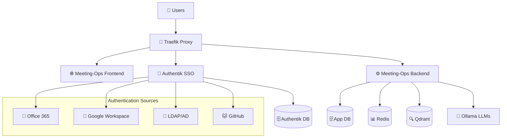

# Meeting-Ops SSO Integration Guide

This guide covers the complete setup of Meeting-Ops with Authentik SSO, supporting Office 365, Google Workspace, LDAP, Active Directory, and more.

## 🏗️ Architecture Overview



## 🚀 Quick Start

### 1. Copy Environment Configuration
```bash
cp .env.sso .env
# Edit .env with your domain and credentials
```

### 2. Configure DNS
```bash
# For local testing, add to /etc/hosts:
./setup-dns.sh

# For production, create DNS A records:
meeting-ops.local        -> YOUR_SERVER_IP
*.meeting-ops.local      -> YOUR_SERVER_IP
```

### 3. Start SSO Stack
```bash
./start-sso.sh
```

### 4. Complete Authentik Setup
1. Go to `https://auth.meeting-ops.local`
2. Complete the initial setup wizard
3. Create admin account
4. Configure OAuth providers

### 5. Test Integration
```bash
./test-sso.sh
```

## 🔧 Configuration

### Environment Variables

| Variable | Description | Example |
|----------|-------------|---------|
| `DOMAIN` | Your domain name | `meeting-ops.company.com` |
| `ACME_EMAIL` | Let's Encrypt email | `admin@company.com` |
| `AUTHENTIK_SECRET_KEY` | Authentik secret (auto-generated) | `random-secure-key` |
| `AZURE_CLIENT_ID` | Office 365 client ID | `abc123...` |
| `AZURE_CLIENT_SECRET` | Office 365 secret | `secret123...` |
| `GOOGLE_CLIENT_ID` | Google Workspace client ID | `123.googleusercontent.com` |
| `LDAP_SERVER_URI` | LDAP/AD server | `ldap://dc.company.com:389` |

### OAuth Provider Setup

#### Office 365 / Azure AD
1. Register app in [Azure Portal](https://portal.azure.com)
2. Add redirect URI: `https://auth.your-domain.com/source/oauth/callback/office365/`
3. Set permissions: `User.Read`, `email`, `openid`, `profile`
4. Update `.env` with client ID, secret, and tenant ID

#### Google Workspace
1. Create project in [Google Cloud Console](https://console.cloud.google.com)
2. Enable Google Identity API
3. Create OAuth2 credentials
4. Add redirect URI: `https://auth.your-domain.com/source/oauth/callback/google/`
5. Update `.env` with client ID and secret

#### LDAP/Active Directory
1. Create service account with read permissions
2. Update `.env` with LDAP settings
3. Test connection: `ldapsearch -H $LDAP_SERVER_URI ...`

### Detailed guides available in `docs/oauth-setup/`

## 🌐 Service URLs

After deployment, access these services:

| Service | URL | Purpose |
|---------|-----|---------|
| **Frontend** | `https://meeting-ops.local` | Main application |
| **API** | `https://api.meeting-ops.local` | Backend API |
| **Auth** | `https://auth.meeting-ops.local` | Authentik SSO |
| **Traefik** | `https://traefik.meeting-ops.local:8080` | Proxy dashboard |
| **Qdrant** | `https://qdrant.meeting-ops.local` | Vector database |
| **Ollama** | `https://ollama.meeting-ops.local` | LLM service |

## 🔐 Security Features

### SSL/TLS
- Automatic Let's Encrypt certificates via Traefik
- TLS 1.2+ with strong cipher suites
- HSTS and security headers

### Authentication
- Forward authentication via Authentik
- JWT tokens with configurable expiry
- Multi-factor authentication support
- Session management

### Authorization
- Role-based access control (RBAC)
- Group-based permissions
- API endpoint protection
- Admin vs user access levels

## 🏢 Enterprise Features

### Single Sign-On (SSO)
- **Office 365**: Azure AD integration
- **Google Workspace**: OAuth2 flow
- **LDAP/AD**: Direct directory integration
- **GitHub**: Developer-friendly auth
- **SAML**: Enterprise identity providers

### Directory Integration
- **Active Directory**: User and group sync
- **LDAP**: Standards-compliant directory
- **Group Mapping**: AD groups to app roles
- **Automatic Provisioning**: User creation

### Compliance & Auditing
- **Audit Logs**: All authentication events
- **Session Tracking**: User activity monitoring
- **Password Policies**: Configurable requirements
- **Access Reviews**: Periodic access validation

## 🔧 Management & Maintenance

### User Management
```bash
# View users in Authentik
curl -H "Authorization: Bearer $AUTHENTIK_API_TOKEN" \
  https://auth.meeting-ops.local/api/v3/core/users/

# Sync LDAP users
docker exec authentik-server ak sync_ldap
```

### Monitoring
```bash
# Check service health
./test-sso.sh

# View logs
docker logs authentik-server
docker logs meeting-ops-traefik

# Monitor authentication
tail -f /var/log/traefik/access.log
```

### Backup & Recovery
```bash
# Backup Authentik data
docker exec authentik-postgres pg_dump -U authentik authentik > authentik-backup.sql

# Backup Meeting-Ops data  
docker exec meeting-ops-postgres pg_dump -U meetingops meeting_sessions > app-backup.sql

# Backup Traefik certificates
tar -czf traefik-certs.tar.gz traefik/
```

## 🚨 Troubleshooting

### Common Issues

#### 1. DNS Resolution
**Problem**: Cannot access auth.meeting-ops.local
**Solution**: 
```bash
# Add to /etc/hosts for local testing
echo "127.0.0.1 meeting-ops.local auth.meeting-ops.local api.meeting-ops.local" >> /etc/hosts

# Or setup proper DNS A records for production
```

#### 2. SSL Certificate Issues
**Problem**: SSL certificate warnings
**Solution**:
```bash
# Check certificate status
echo | openssl s_client -connect auth.meeting-ops.local:443

# For local development, accept self-signed certificates
# For production, ensure DNS is properly configured
```

#### 3. Authentik Not Starting
**Problem**: Authentik containers failing
**Solution**:
```bash
# Check logs
docker logs authentik-server
docker logs authentik-postgres

# Common fix: Reset database
docker compose -f docker-compose-sso.yml down -v
docker compose -f docker-compose-sso.yml up -d
```

#### 4. OAuth Provider Issues
**Problem**: OAuth login fails
**Solution**:
1. Verify redirect URIs match exactly
2. Check client ID/secret configuration  
3. Ensure required scopes are granted
4. Test with API calls to verify setup

### Debug Commands
```bash
# Test Authentik API
curl -k https://auth.meeting-ops.local/api/v3/core/applications/

# Check Traefik routes
curl -k https://traefik.meeting-ops.local:8080/api/http/routers

# Verify forward auth headers
curl -k -H "X-authentik-username: test" https://api.meeting-ops.local/api/status

# Test LDAP connection
ldapsearch -H ldap://dc.company.com -D "CN=service,DC=company,DC=com" -w password -b "DC=company,DC=com"
```

## 📚 Additional Resources

- [Authentik Documentation](https://goauthentik.io/docs/)
- [Traefik Documentation](https://doc.traefik.io/traefik/)
- [OAuth 2.0 Specification](https://tools.ietf.org/html/rfc6749)
- [OpenID Connect](https://openid.net/connect/)

## 🛡️ Production Checklist

### Security
- [ ] Change default passwords
- [ ] Enable 2FA for admin accounts
- [ ] Configure strong password policies
- [ ] Set up audit logging
- [ ] Review user permissions
- [ ] Enable session timeout

### Infrastructure
- [ ] Use production SSL certificates
- [ ] Configure DNS properly
- [ ] Set up monitoring/alerting
- [ ] Configure backups
- [ ] Test disaster recovery
- [ ] Document procedures

### Integration
- [ ] Test all OAuth providers
- [ ] Verify LDAP/AD sync
- [ ] Validate group mappings
- [ ] Test API authentication
- [ ] Verify WebSocket auth
- [ ] Performance testing

---

## 💡 Tips & Best Practices

1. **Use Groups for Authorization**: Map AD/LDAP groups to Meeting-Ops roles
2. **Monitor Authentication**: Set up alerts for failed logins
3. **Regular Updates**: Keep Authentik and Traefik updated
4. **Test Regularly**: Verify OAuth flows still work
5. **Backup Everything**: Database, certificates, configurations
6. **Document Changes**: Keep track of OAuth app configurations

For support, see the troubleshooting section or check the logs for specific error messages.